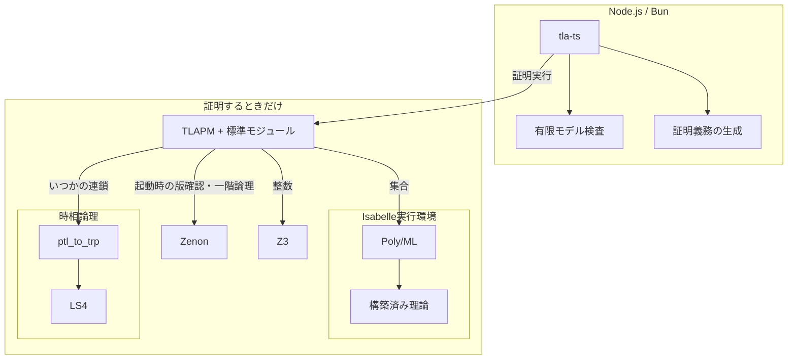
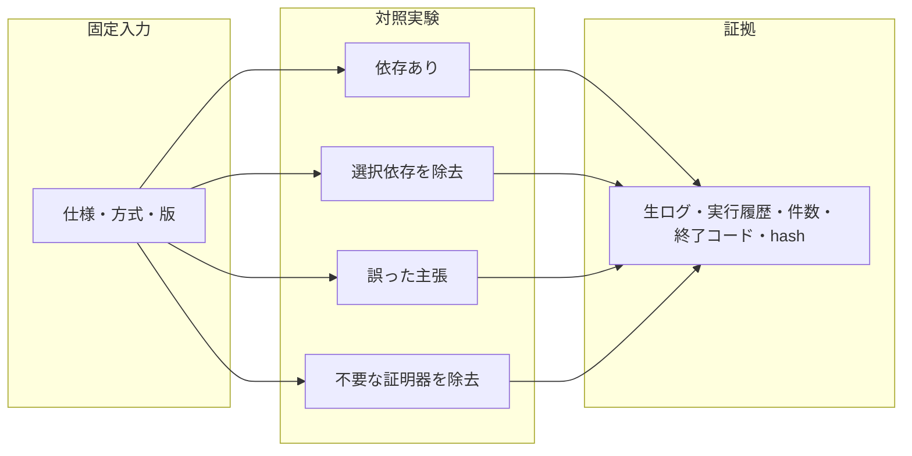

# proofs

**TLA+をNode.js / Bunから実行し、必要な外部依存だけを実測する。**

実行器は `run.mjs` 1本、証明シナリオは4件のデータ。GitHub Actionsで **25条件 × 2環境 = 50/50** を確認した。[実測結果・固定版・限界](RESULTS.md)。

「必須」はこの版・実行方式で必要という意味。その数学的問題を他の証明器で解けないという意味ではない。シナリオMMDは実装前のcommit `a3d37e454ca4a5f6ab67c246f125ebaf6ae4e285` で先に保存した。以下は実測後の構成。

## 用途と最小依存

全行にNode.jsまたはBunと `tla-ts@0.0.3` が必要。表は調べた証明ツールの範囲であり、OSの標準コマンド・ライブラリは省略する。

| 用途 | 最小シナリオ | 追加する依存 | 除去時 |
|---|---|---|---|
| 有限モデルの検査 | カウンタ0〜3、上限違反には反例 | なし | 全証明ツールを外しても成功 |
| 証明義務の生成だけ | 論理式を証明すべき主張へ分ける | なし | 全証明ツールを外しても生成成功 |
| 証明の実行 | 以下の4方式を実行する入口 | TLAPMと標準モジュール | TLAPMなしでは終了コード1 |
| 一階論理の証明 | 全員が条件を満たすなら、その一人も満たす | TLAPM + Zenon | Zenonなしでは終了コード3 |
| 整数の大小関係 | 全整数nについて n < n+1 | TLAPM + Zenon + Z3 | Z3なしでは終了コード10 |
| 集合の包含 | AとBの共通部分はAに含まれる | TLAPM + Zenon + IsabelleのPoly/ML・理論 | Poly/MLまたは理論なしでは終了コード10 |
| 時間に沿った性質 | pからいつかq、qからいつかrなら、pからいつかr | TLAPM + Zenon + ptl_to_trp + LS4 | 変換器またはLS4なしでは終了コード10 |

**観測した追加依存:** このTLAPM版は証明器を選ぶ前に `zenon -v` を実行する。Z3・Isabelle・LS4だけを選んでも、Zenon不在で起動に失敗する。Zenonがそれらの証明を代行しているわけではない。

## 検証の流れ

偽物の証明器は使わない。毎回新しいディレクトリでキャッシュを消し、実物の依存を一時除去して復帰する。0件の証明義務、終了コード0だけ、時間切れを成功に含めない。詳細は `raws.jsonl` と `disruptives.jsonl`。

## 再実行

Actionsの `proofs` ワークフローが導入から保存まで行う。ローカルではLinux x86_64で、同ワークフローの固定版TLAPSを `.tools/tlapm` へ展開し、`strace` と `timeout` を用意する。`npm ci` の後に `node run.mjs` または `bun run.mjs` を実行する。`TLAPS_ROOT` で展開先を変更できる。

**検証専用のTLAPSコピーを使うこと。** 除去テスト中に同じインストールを別の仕事から使わない。証拠は `evidence/` に保存する。Actionsのartifact保持期間は30日。

## 一次資料

- [tla-ts](https://github.com/aidenybai/tla-ts): モデル検査と証明実行の境界。
- [TLAPS tactics](https://proofs.tlapl.us/doc/web/content/Documentation/Tutorial/Tactics.html): 証明器の選択。
- [TLAPS advanced options](https://proofs.tlapl.us/doc/web/content/Documentation/Tutorial/Advanced_options.html): strict・キャッシュ。
