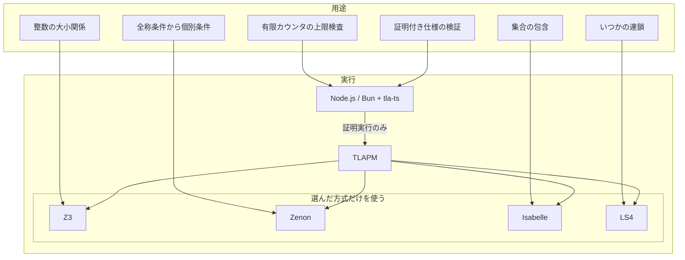
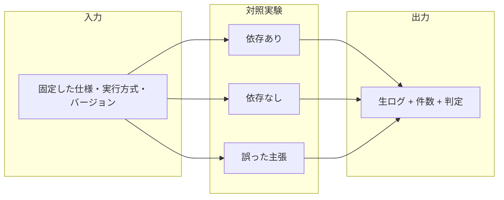

# proofs

TLA+をNode.js / Bunから実行する最小の依存検証。

**範囲:** 有限モデルの検査と定理証明を分ける。「必須」は固定した実行経路での必要性であり、その数学的問題を他の証明器で解けないという意味ではない。

## 先に固定するシナリオ

| 対象 | ユースケース | 成功条件 | 依存を外した対照 |
|---|---|---|---|
| 外部証明器なし | 有限カウンタが上限を守るか | 正常仕様は成功、誤った上限には反例 | TLAPMもJavaも要求しない |
| TLAPM | 証明付き仕様を最後まで検証する | 証明義務が1件以上あり、すべて証明済み | `tla-ts prove`がTLAPM不在を報告 |
| Z3 | 整数の大小関係を証明する | Z3を指定した算術証明が成功 | 同じ経路でZ3を外すと未証明 |
| Zenon | 全称条件から個別の条件を導く | Zenonを指定した一階論理の証明が成功 | 同じ経路でZenonを外すと未証明 |
| Isabelle | 集合の包含関係を証明する | Isabelleを指定した集合の証明が成功 | 同じ経路でIsabelleを外すと未証明 |
| LS4 | 「いつか」の連鎖を証明する | PTLを指定した時相論理の証明が成功 | 同じ経路でLS4を外すと未証明 |

## 実証の契約

各証明器について、同じ仕様の「利用可能」「その依存を除去」「誤った主張」の3条件を実行する。キャッシュを使わず、終了コードだけでなく証明義務の件数と結果を確認する。タイムアウト、未実行、証明義務0件を成功に含めない。生ログとJSONLを保存する。

## 出典

- [tla-ts README](https://github.com/aidenybai/tla-ts): モデル検査はJS内、証明実行は外部TLAPMへ委譲。
- [TLAPS tactics](https://proofs.tlapl.us/doc/web/content/Documentation/Tutorial/Tactics.html): バックエンドの明示指定と代替。
- [TLAPS advanced options](https://proofs.tlapl.us/doc/web/content/Documentation/Tutorial/Advanced_options.html): 証明器、キャッシュ、strict判定。

この文書は実行前の計画。実測結果は検証ログを参照し、未実行を達成扱いにしない。
