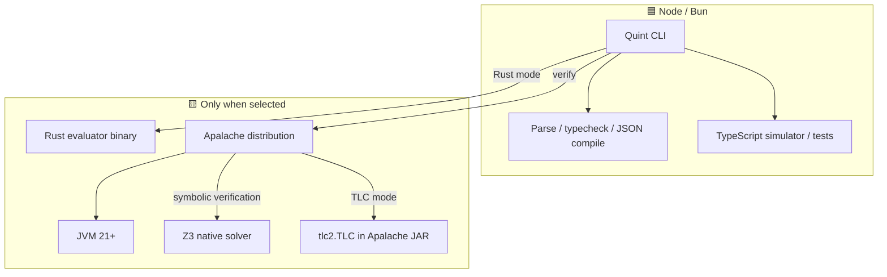
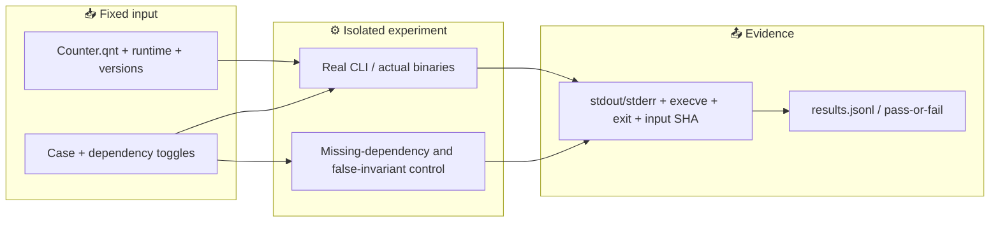

# Quint dependency boundaries — scenario contract

Parent: [TLA+ proof PR #1](https://github.com/roccho-dev/proofs/pull/1). This is a **stacked, draft-only** experiment, not a request to merge either PR.

The test target is **Quint 0.33.1** on Node 22.16.0 and Bun 1.3.0. `run`/`test` default to the **Rust** evaluator; `--backend=typescript` selects JS-only execution. `verify` is different: it invokes Apalache or TLC and requires a JVM. “Required” here means required by this fixed command path, not by formal logic in general.

## Scenarios (specified before implementation)

| Case | Model / check | Expected success | Negative control |
|---|---|---|---|
| JS-only | Counter invariant, known passing and failing tests, typecheck | Parse + test + run using `--backend=typescript`, without spawning Java, Rust evaluator or Apalache | Bad invariant/test is rejected |
| Rust evaluator | Same passing test through `--backend=rust` | Real Rust evaluator process executes | Make installed evaluator non-executable: test is rejected |
| Apalache / JVM | Counter invariant under `quint verify --backend=apalache` | Bounded model check succeeds; real JVM/Apalache path observed | Disable installed Apalache launcher; verify must fail |
| TLC / JVM / JAR | Same finite model under `--backend=tlc` | Explicit-state verification succeeds via `tlc2.TLC` | Remove cached Apalache JAR after compilation is available: verify must fail |
| Counterexample | A deliberately false invariant | Backend reports a violation, not `[ok]` | No “failure = success” by exit code alone |

**Not assumed:** Rust compiler is required; Java is required for simulation; `verify` is JS-only; Java-free Quint `verify` is established by `tla-ts`; Apalache is exhaustive for unbounded executions. The Z3 native solver is a *transitive* Apalache dependency; its binary-level removal is a separate optional diagnostic, not an automatic proof of necessity.

## Package dependency graph

## Evidence flow

## Acceptance

No simulated success, no 0-test success, no success on timeout or an unobserved backend. Keep native execution only in per-job `QUINT_HOME`; restore all permissions in `finally`. Commit the executable implementation after this scenario contract. Independent Node and Bun jobs emit raw logs; a result is `PASS` only when both the claim and its control match observed evidence.

Upstream: [Quint CLI](https://quint.sh/docs/quint), [release v0.33.1](https://github.com/quint-co/quint/releases/tag/v0.33.1), [Rust evaluator manager](https://github.com/quint-co/quint/blob/main/quint/src/rust/binaryManager.ts), [TLC runner](https://github.com/quint-co/quint/blob/main/quint/src/tlc.ts).
