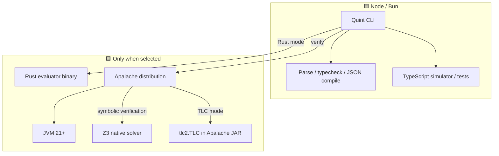
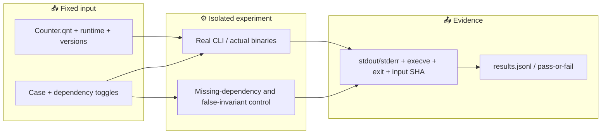

# Quint dependency boundaries — scenario contract

Parent: [TLA+ proof PR #1](https://github.com/roccho-dev/proofs/pull/1). This is a **stacked, draft-only** experiment, not a request to merge either PR.

The test target is **Quint 0.33.1** on Node 22.16.0 and Bun 1.3.0. `run`/`test` default to the **Rust** evaluator; `--backend=typescript` selects JS-only execution. `verify` is different: it invokes Apalache or TLC and requires a JVM. “Required” here means required by this fixed command path, not by formal logic in general.

## Scenarios (specified before implementation)

| Case | Model / check | Expected success | Negative control |
|---|---|---|---|
| JS-only | Counter invariant, known passing and failing tests, typecheck | Parse + test + run using `--backend=typescript`, without spawning Java, Rust evaluator or Apalache | Bad invariant/test is rejected |
| Rust evaluator | Same passing test through `--backend=rust` | Real Rust evaluator process executes | Make installed evaluator non-executable: test is rejected |
| Apalache / JVM | Counter invariant under `quint verify --backend=apalache` | Bounded model check succeeds; real JVM/Apalache path observed | Disable installed Apalache launcher; verify must fail |
| TLC / JVM / JAR | Same finite model under `--backend=tlc` | Explicit-state verification succeeds via `tlc2.TLC` | False invariant produces an actual counterexample. **JAR isolation not yet tested** |
| Counterexample | A deliberately false invariant | Backend reports a violation, not `[ok]` | No “failure = success” by exit code alone |

**Not assumed:** Rust compiler is required; Java is required for simulation; `verify` is JS-only; Java-free Quint `verify` is established by `tla-ts`; Apalache is exhaustive for unbounded executions. The Z3 native solver is a *transitive* Apalache dependency; its binary-level removal is a separate optional diagnostic, not an automatic proof of necessity.

## Package dependency graph

## Evidence flow

## Acceptance

No simulated success, no 0-test success, no success on timeout or an unobserved backend. Keep native execution only in per-job `QUINT_HOME`; restore all permissions in `finally`. Commit the executable implementation after this scenario contract. Independent Node and Bun jobs emit raw logs; a result is `PASS` only when both the claim and its control match observed evidence.

Upstream: [Quint CLI](https://quint.sh/docs/quint), [release v0.33.1](https://github.com/quint-co/quint/releases/tag/v0.33.1), [Rust evaluator manager](https://github.com/quint-co/quint/blob/main/quint/src/rust/binaryManager.ts), [TLC runner](https://github.com/quint-co/quint/blob/main/quint/src/tlc.ts).

## Measured result — 2026-10-31 JST

- **26/26 controls passed:** Node 13/13 and Bun 13/13, each in its own GitHub Actions VM, at implementation SHA `66655b326c16add3eb7bfa241f4971c7c3cd0a6a`.
- [Successful CI run](https://github.com/roccho-dev/proofs/actions/runs/41110155773). [Node raw evidence](https://github.com/roccho-dev/proofs/actions/runs/41110155773/artifacts/13003317340) (1,846,155 bytes); [Bun raw evidence](https://github.com/roccho-dev/proofs/actions/runs/41110155773/artifacts/13002938040) (1,846,060 bytes). Artifact retention: 30 days.
- Both used identical `Counter.qnt` SHA256 `f3a81cd820ddfe97d6b15edb66288ae01ac3cb98d7f2730866074541b7f4868e`.
- Cases per runtime: **5 JS-only** (typecheck, TS test pass/fail, simulation pass/violation), **2 Rust** (present/disabled), **3 Apalache** (present/disabled/violation), **2 TLC** (present/violation), **1 JVM absent** (expected failure).
- Proof is from process `execve` traces, stdout, stderr and exit status, **not only GitHub's green CI indicator**. The TS path launched no Java, Rust evaluator or Apalache. The Rust test spawned `quint_evaluator`; removing its execute permission prevented test success. Both model checkers launched real Java; removing Apalache launcher or masking Java prevented success.
- First run [41109776883](https://github.com/roccho-dev/proofs/actions/runs/41109776883) was **12/13 each, failed** due to incorrectly expecting output from a silent successful `typecheck`; no fake success was claimed. It also uploaded the 195 MB native distribution. The final run moves `QUINT_HOME` outside the uploaded evidence, reducing artifact sizes to ~1.85 MB each.

### Scope of claims

These tests establish **runtime-path dependencies only** for Quint 0.33.1, evaluator v0.7.1 and Apalache 0.62.4 under Node 22.16.0/Bun 1.3.0, Linux x86-64 and Java 21. They do not prove exhaustive coverage of arbitrary Quint specs, Java-free `quint verify`, solver correctness, or completeness of the TLA+ translation. `quint run` is sampling, Apalache verifies bounded runs (here at most 4 steps). TLC does explicit-state enumeration for this finite counter. **Z3 native-library and Apalache JAR removal were not independently tested.** Rust evaluator, Z3 and TLC are provided through fetched distributions; a separate Rust compiler, `z3` executable or `tlc` package is not established as a requirement here. Direct CLI version pins do not fully pin npm transitive dependencies; this is a Draft experiment, not a production lockfile claim.

### Final design choice

Keep the Quint-specific runner separate from the TLAPM/TLA+ runner, sharing **only the stable evidence schema** (`runtime, case, source hash, executable path, observed process, output hash, result`). The execution semantics and removable dependencies differ. A generic plugin framework now would increase code and hidden coupling; deduplicate the evidence recorder only after a real third use case demonstrates benefit.
